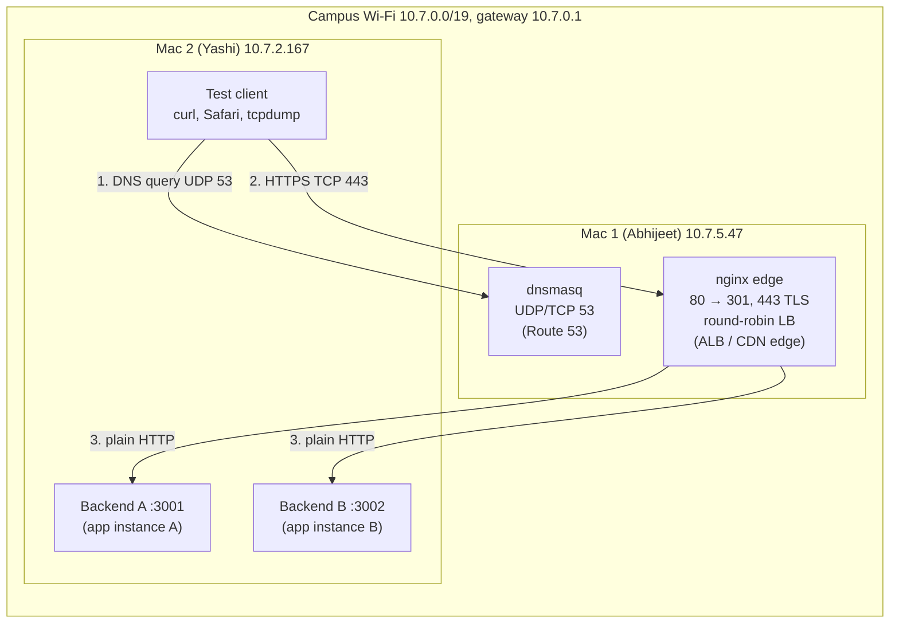

# Architecture: Team Epic Router (`teamepicrouter`), Phase 1

Submission type: **Type 2: two Macs with combined roles.** Owner of this doc: Nishant.

## Topology

Mac 1 is also a client (curl / browser on Mac 1 resolves through dnsmasq via `/etc/resolver`).

## IP and service table

| Machine | Owner | Interface | IPv4 / prefix | Mask | Gateway | MAC (in use on Wi-Fi) | Services | Ports |
|---|---|---|---|---|---|---|---|---|
| Mac 1 | Abhijeet | en0 (Wi-Fi) | 10.7.5.47/19 | 255.255.224.0 | 10.7.0.1 | 1a:19:57:39:0d:7b (private Wi-Fi address; hardware 80:a9:97:44:e7:17) | dnsmasq, nginx | 53/UDP+TCP, 80, 443 |
| Mac 2 | Yashi | en0 (Wi-Fi) | 10.7.2.167/19 | 255.255.224.0 | 10.7.0.1 | ce:b1:41:a9:05:6a (private Wi-Fi address; hardware 10:9f:41:b9:4e:b2) | Backend A, Backend B, test client | 3001, 3002 |

DNS records (dnsmasq, TTL 30 s):

| Name | Type | Value |
|---|---|---|
| app.teamepicrouter.test | A | 10.7.5.47 (Mac 1, nginx) |
| api.teamepicrouter.test | A | 10.7.5.47 (Mac 1, nginx) |

Macs use a "private Wi-Fi address" (a randomised MAC per network), so the MAC seen on the LAN differs from the hardware MAC.

## Request flow, one `curl https://app.teamepicrouter.test/api/status` from Mac 2

| # | Step | Protocol / ports | OSI layer | TCP/IP layer |
|---|---|---|---|---|
| 1 | Mac 2 asks "what is the IP of app.teamepicrouter.test?" to its only DNS server, Mac 1 | DNS over UDP, ephemeral port → 10.7.5.47:53 | 7 Application (DNS), 4 Transport (UDP) | Application / Transport |
| 2 | dnsmasq answers `A 10.7.5.47`, TTL 30 | UDP 53 → ephemeral | 7 / 4 | Application / Transport |
| 3 | Before any IP packet leaves, Mac 2 finds Mac 1's MAC with ARP; frames go over Wi-Fi | ARP, 802.11 | 2 Data link | Link |
| 4 | IP packets routed directly (same subnet, no router hop) | IPv4 10.7.2.167 ↔ 10.7.5.47 | 3 Network | Internet |
| 5 | TCP three-way handshake: SYN → SYN-ACK → ACK | TCP ephemeral → 443 | 4 Transport | Transport |
| 6 | TLS handshake: ClientHello (SNI = app.teamepicrouter.test) → ServerHello → Certificate → key exchange → ChangeCipherSpec/Finished. Client checks the cert name + trust | TLS on TCP 443 | 5/6 Session/Presentation | Application (TLS sits between app and TCP) |
| 7 | Encrypted HTTP/2 (or HTTP/1.1) request `GET /api/status` | TLS Application Data | 7 Application | Application |
| 8 | nginx decrypts, picks the next backend round-robin, opens a **new** TCP connection to 10.7.2.167:3001 or :3002, sends **plain** HTTP with `X-Forwarded-For`, `X-Forwarded-Proto: https` | HTTP/1.1 request (Python answers HTTP/1.0) over TCP, nginx ephemeral port → 3001/3002 | 7 / 4 | Application / Transport |
| 9 | Backend replies JSON + `X-Backend: A`/`B`; nginx re-encrypts and returns it to the client | HTTP → TLS | 7 | Application |

## Cloud equivalents

| Our piece | Cloud equivalent | Same idea |
|---|---|---|
| dnsmasq on Mac 1 | AWS Route 53 (private hosted zone) | Name → IP, with a TTL |
| nginx on Mac 1 | AWS ALB / GCP HTTPS Load Balancer, or a CDN edge (CloudFront) | Single public entry point, TLS termination, spreads load, hides backends |
| server.py A and B | EC2 instances / containers in a target group | Identical app copies behind the LB |
| `max_fails` / `fail_timeout` | ALB target health checks | Stop sending traffic to a dead target |
| Self-signed cert in Keychain | ACM certificate from a public CA | Proves the server owns the name |

## Trade-offs of combining roles (Type 2)

- **Fewer machines, more single points of failure.** If Mac 1 goes down, DNS **and** the edge die together. If Mac 2 goes down, **both** backends die together, so "two backends" only protects against an app crash, not a machine failure.
- **Mac 1 resolves through `/etc/resolver`, not system-wide DNS.** Only `*.teamepicrouter.test` lookups go to dnsmasq (127.0.0.1), so Mac 1 keeps normal internet if dnsmasq stops. It still counts as resolving through our DNS server: `dscacheutil -q host -a name app.teamepicrouter.test` uses the system resolver and gets the answer from dnsmasq. Note: macOS `dig` ignores `/etc/resolver`, so on Mac 1 use `dig @127.0.0.1`.
- **Mac 2 uses Mac 1 as its only system-wide DNS server**, exactly as the PDF describes. That also means Mac 2 loses all name resolution if dnsmasq stops (undo with `mac2/undo-dns.sh`).
- **The packet capture is on Mac 2**, because every hop crosses the Wi-Fi: client→edge (DNS, 443) and edge→backend (3001/3002) both touch Mac 2's `en0`. So one capture shows both the encrypted and the plain side of the edge.

## Notes that differ from the course template

- nginx upstream `zone` is **128k**, not 64k. Apple Silicon has 16 KB memory pages and nginx needs at least 8 pages per zone.
- nginx 1.31 uses `http2 on;` (the `listen … http2` form is for < 1.25.1).
- nginx and dnsmasq come from Homebrew (`/opt/homebrew`). nginx runs without sudo; dnsmasq needs sudo for port 53 and runs in the background via `mac1/start-dnsmasq.sh`.
